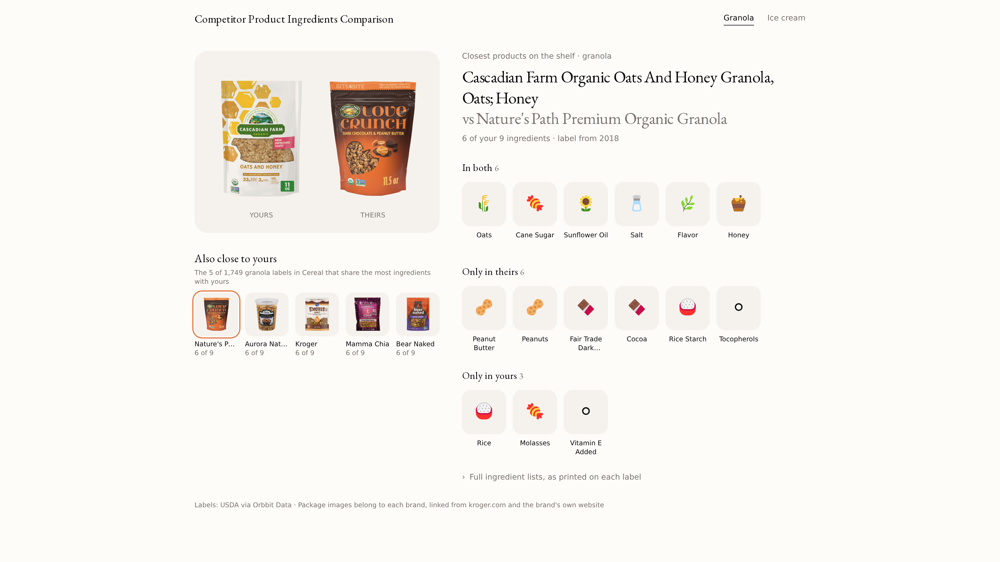

# Competitor Product Ingredients Comparison

A feature you add to software for food brands: on each product page, the closest competing products on the shelf, and which ingredients both use, only theirs uses, and only yours uses.



**Data set:** [Branded Food Labels](https://www.orbbit.co/data/developers/data-directory) · **Endpoint:** [`GET /v1/branded-foods`](https://docs.orbbit.co/industry-data/cpg/branded-food) · **Cost:** $0.01 per 200 labels, cached for 7 days

## Who this is for

Developers building software for food and beverage brands: product development and recipe tools, spec sheet and compliance software, retail buyer tools, and AI agents that help a brand plan its next product. Your product already stores your customers' recipes or the products they sell.

## The problem

A brand team planning a recipe wants to know who makes something like it and what they do differently. Today that means walking a store aisle or reading labels one by one online.

The labels are public. US brands report each packaged food's ingredient statement to USDA. Turning those reports into something your product can search is its own project: collecting each release, keeping every label, and cleaning ingredient text that each brand writes its own way.

## What this demo is

A small Next.js app that shows the finished feature for two real products, Cascadian Farm oats and honey granola and Tillamook chocolaty chip cookie dough ice cream. Each page reads the product's own label, then compares it with every other label of the same type.

You copy one file, plus the panel if you want it. The rest of the app is there so you can see the feature working before you copy it.

## Why use Orbbit Data for it

- **No data pipeline to build.** Orbbit Data already collects the USDA labels and serves them by name, category, barcode or ingredient.
- **Pay per request.** Each request returns up to 200 labels for $0.01, with no subscription or minimum. The 1,749 granola labels take 9 requests, $0.09, and the demo keeps the result for 7 days.
- **A feature to sell.** A side-by-side with real competitors is something your customers cannot get from their own records, so it can sit in a paid plan.
- **Ready for coding agents.** One file, a server-only API key, a cache and tests. You or your coding agent can follow the steps below as written.

## How to read it

The closest products are the labels that share the most ingredients with yours. A tie goes to the shorter ingredient list, and each brand appears once. Ingredients are compared after cleaning, so "ORGANIC ROLLED OATS" and "WHOLE GRAIN OATS" both count as oats, and "SEA SALT" counts as salt.

An asterisk in a label, as in "OATS*, ... *ORGANIC", is the brand's own footnote; the cleaning drops it. Each label is as the brand last reported it to USDA, sometimes years ago, so the page shows each label's year. Use it to compare recipes, never to say a product is safe for an allergy. The full ingredient lists, as printed, open under the comparison.

## How to use it

1. Copy [`lib/competitor-ingredients.ts`](./lib/competitor-ingredients.ts) into your project. It calls Orbbit Data, cleans each ingredient list, ranks the closest products and caches each result for 7 days. It runs only on the server, because it reads `ORBBIT_DATA_API_KEY`.

2. Call it from a server component on your product page:

   ```tsx
   import { getCachedClosestCompetitors } from '@/lib/competitor-ingredients'

   const result = await getCachedClosestCompetitors(
     'WHOLE GRAIN OATS, CANE SUGAR, RICE, SUNFLOWER OIL, HONEY, SEA SALT', // your customer's recipe, written like a label
     'granola', // a word competing products' names contain
     'Cereal', // the category to search
   )
   ```

   `result.closest` lists the closest products, each with its brand, name, label year, ingredients in label order, and what only it uses (`onlyThem`) and only yours uses (`onlyYou`).

3. Optional: copy the panel in [`components/competitor-panel.tsx`](./components/competitor-panel.tsx) to show the result as in the screenshot. It uses package images from [`lib/product-images.ts`](./lib/product-images.ts) and [`lib/image-bounds.ts`](./lib/image-bounds.ts).

Pick the category from [`GET /v1/branded-foods/categories`](https://docs.orbbit.co/industry-data/cpg/branded-food), which is free. Keep the panel's source line, "Labels: USDA via Orbbit Data".

Outside Next.js, delete the last section of `lib/competitor-ingredients.ts` and call `getClosestCompetitors({ recipe, query, category, apiKey })` with your own cache.

### About the package images

The images belong to each brand. The demo links to them on kroger.com, which serves a front-of-pack image for each barcode it sells, or to the brand's own website. It never copies them, and it shows only competitors that have an image. Check that your use of brand images fits your product before you ship it.

## Run the demo

```bash
cd examples/branded-food-labels/competitor-product-ingredients
cp .env.example .env.local   # then paste your API key
npm install
npm run dev
```

Open http://localhost:3000. It shows the granola and ice cream products listed in [`lib/sample-products.json`](./lib/sample-products.json).

```bash
npm test             # the cleaning and ranking, with the API faked
npm run screenshot   # rewrite assets/demo.png while the demo runs
```
