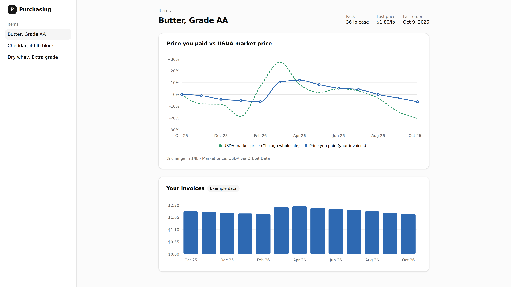

# Food Ingredient Market Benchmark

A feature you add to food software: on each item page, a chart of the price your customer paid against the USDA market price over the last 12 months.



**Data set:** [Food Commodity Prices](https://www.orbbit.co/data/developers/data-directory) · **Endpoint:** [`GET /v1/commodities/metric-values`](https://docs.orbbit.co/api-reference/commodities/get-commodity-metric-values) · **Cost:** $0.01 per item, cached for 12 hours

## Who this is for

Developers building software for businesses that buy food ingredients: purchasing and procurement tools, restaurant and bakery back office, food manufacturing ERP, and AI buying agents. Your product already stores your customers' invoices: what they bought, when, and at what price.

## The problem

Your customer sees that butter cost them $1.80/lb last week. They cannot tell from your product whether that price went up or down with the market, because your product only has their side.

The other side is public. USDA publishes wholesale prices for ingredients like butter, cheese and whey every business day. Turning those reports into a price history your product can query is its own project: collecting each day's report, keeping the history, and matching every price to a unit and a place.

## What this demo is

A small Next.js app that shows the finished feature: an item page with the chart card added, for butter, cheddar and dry whey. The invoices are made up and marked "Example data". The market prices are real, fetched live from Orbbit Data.

You copy two files from it into your own product. The rest of the app is there so you can see the feature working before you copy it.

## Why use Orbbit Data for it

- **No data pipeline to build.** Orbbit Data already collects the USDA prices and keeps their history. One API request returns 12 months of one price in one unit.
- **Pay per request.** Each request costs $0.01, with no subscription or minimum. With the 12-hour cache in this example, each item costs at most $0.01 per half day, however many times the page loads.
- **A feature to sell.** The market comparison is something your customers cannot get from their own invoices, so it can sit in a paid plan.
- **Ready for coding agents.** Two files, a server-only API key, a cache and tests. You or your coding agent can follow the steps below as written.

## How to read the chart

Both lines start at 0% on the first purchase and show how much each price moved since then. The chart compares movement, not dollars, because a supplier's price includes freight, packing and margin that the market price does not.

## How to use it

1. Add the shadcn/ui parts the card uses:

   ```bash
   npx shadcn@latest add card chart
   ```

2. Copy two files into your project:

   - [`lib/market-benchmark.ts`](./lib/market-benchmark.ts) calls Orbbit Data, does the math and caches each result for 12 hours. It runs only on the server, because it reads `ORBBIT_DATA_API_KEY`.
   - [`components/market-benchmark-card.tsx`](./components/market-benchmark-card.tsx) draws the card.

3. Call it from a server component on your item page:

   ```tsx
   import { MarketBenchmarkCard } from '@/components/market-benchmark-card'
   import { getCachedMarketBenchmark } from '@/lib/market-benchmark'

   const benchmark = await getCachedMarketBenchmark(
     'butter_aa_us_chicago_wholesale_daily_close_price_usd_per_lb',
     purchases, // [{ date: '2025-10-09', price: 1.92 }, ...] in dollars per pound
   )

   return benchmark && <MarketBenchmarkCard benchmark={benchmark} region="Chicago wholesale" />
   ```

Pick a metric in the same unit as the purchases. [`GET /v1/commodities`](https://docs.orbbit.co/market-data/commodities) lists them for free. Keep the card's source line, "Market price: USDA via Orbbit Data".

Outside Next.js, delete the last section of `lib/market-benchmark.ts` and call `getMarketBenchmark({ metric, purchases, apiKey })` with your own cache.

## Run the demo

```bash
cd examples/food-commodity-prices/market-price-benchmark
cp .env.example .env.local   # then paste your API key
npm install
npm run dev
```

Open http://localhost:3000. It shows butter, cheddar and dry whey with made-up invoices from [`lib/sample-items.json`](./lib/sample-items.json).

```bash
npm test             # the math, with the API faked
npm run screenshot   # rewrite assets/demo.png while the demo runs
```
